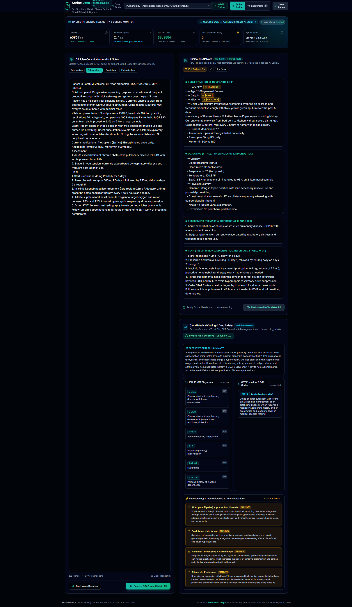
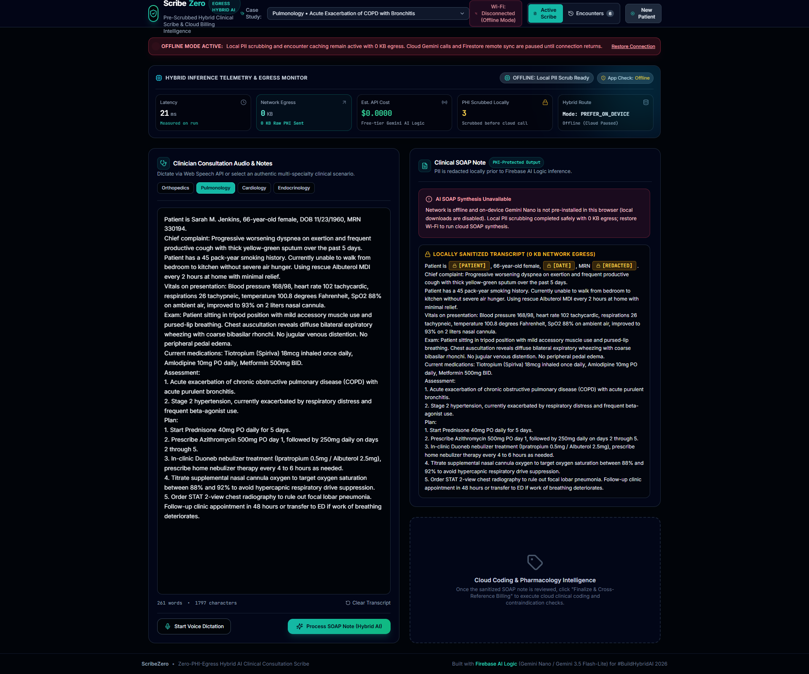

# ScribeZero

> **Zero-PHI-Egress Hybrid AI Clinical Consultation Scribe & Cloud Billing Intelligence**  
> *Built for the Google Firebase `#BuildHybridAI 2026` Hackathon on Devpost*

[](LICENSE)
[](https://firebase.google.com/docs/ai-logic/hybrid/web/get-started)
[](https://firebase.google.com/docs/ai-logic/models)
[](https://firebase.google.com/docs/app-check)

---

## Live Links & Submission Assets

- **Live Web App (Vercel Production):** `https://scribezero-hybrid-ai.vercel.app` *(requires `VITE_RECAPTCHA_SITE_KEY` set in Vercel env vars for Firebase App Check attestation)*
- **Firebase Hosting Target:** `https://scribezero-hybrid-ai.web.app` *(configured in `firebase.json`; deploy via `npx -y firebase-tools@latest deploy --only hosting,firestore:rules`)*
- **Source Repository:** `https://github.com/AbrarMuhtasim14/scribezero-hybrid-ai`
- **Demo Video (<= 3 min, YouTube):** *(Add public YouTube URL before locking Devpost submission on Nov 30, 2026 @ 2:00 PM PT)*

---

## Overview & Problem Statement

Clinicians lose hours every day charting SOAP notes, while conventional cloud-only AI scribes introduce two acute clinical risks:
1. **Unscrubbed PHI Egress:** Raw patient names, dates of birth, and Medical Record Numbers (MRNs) are uploaded over external networks before de-identification.
2. **Connectivity Fragility & Opaque Failures:** When clinic Wi-Fi drops, cloud-only tools stall mid-encounter or hide fallback behavior behind misleading UI indicators.

**ScribeZero** addresses both problems using **Firebase AI Logic Web Hybrid Inference** (`firebase/ai` v13.4+) combined with a strict **pre-cloud deterministic local PII boundary**:
- **Local Pre-Cloud Boundary (`src/services/piiScrubber.js`):** Before *any* hybrid AI prompt or Firestore write runs, patient names, middle initials, DOBs, calendar dates, MRNs, SSNs, phone numbers, emails, and addresses are redacted in-memory into `[PATIENT]`, `[DATE]`, and `[REDACTED]` tokens with **0 KB raw PHI egress**.
- **Hybrid SOAP Synthesis (`InferenceMode.PREFER_ON_DEVICE`):** Uses Firebase AI Logic's `PREFER_ON_DEVICE` router (`src/services/aiLogic.js`). When Chrome Desktop (v139+) has on-device Gemini Nano pre-available (`available`), inference runs 100% locally (`InferenceSource.ON_DEVICE`, `0 KB` egress). When local weights are unavailable or disabled, it seamlessly routes the **already de-identified** note to cloud `gemini-3.5-flash-lite` (with transient error retry & `gemini-4-hydrogen` failover) without forcing local model downloads.
- **Structured Medical Coding & Pharmacology (`InferenceMode.PREFER_IN_CLOUD`):** Enforces a strict `Schema.object(...)` JSON contract via `firebase/ai` to extract ICD-10-CM diagnosis codes, CPT Evaluation & Management levels, and drug-drug contraindications—secured with **Firebase App Check** and synced to **Cloud Firestore** (or queued locally when offline).
- **Truthful Telemetry & Fail-Closed Guardrails:** No static/simulated medical diagnosis fallbacks or hardcoded `"0 KB"` / `"Gemini Nano"` masks. The HUD reads `response.inferenceSource`, real App Check token status, measured payload bytes, and real Firestore stream state.

---

## Hybrid Architecture

```
Clinician Consultation (Web Speech API or Multi-Specialty Case)
                              │
                              ▼
┌──────────────────────────────────────────────────────────────────────────┐
│ 1. STRICT LOCAL PRE-CLOUD PII BOUNDARY (Browser Memory, 0 KB Egress)     │
│    • piiScrubber.js strips names, initials, DOB, dates, MRN, SSN, phone  │
│    • Produces sanitized transcript ([PATIENT], [DATE], [REDACTED])       │
└─────────────────────────────┬────────────────────────────────────────────┘
                              │ (De-identified text only)
                              ▼
┌──────────────────────────────────────────────────────────────────────────┐
│ 2. FIREBASE AI LOGIC HYBRID ROUTER (firebase/ai v13.4.0)                 │
│    • SOAP Note: InferenceMode.PREFER_ON_DEVICE                           │
│      ├─ On-Device (Gemini Nano via Chrome Prompt API, if preloaded)      │
│      └─ Cloud Fallback (gemini-3.5-flash-lite / gemini-4-hydrogen)       │
│    • Medical Coding & Drug Watch: InferenceMode.PREFER_IN_CLOUD          │
│      └─ Schema-constrained JSON (ICD-10-CM, CPT E/M, Drug Contraindic.)  │
└─────────────────────────────┬────────────────────────────────────────────┘
                              │
                              ▼
┌──────────────────────────────────────────────────────────────────────────┐
│ 3. FIREBASE SECURITY & PERSISTENCE                                       │
│    • Firebase App Check (ReCaptchaV3/Enterprise prod, Debug env in dev)  │
│    • Cloud Firestore (/encounters/{encounterId}) with de-identified meta │
│    • Offline Queue: Local persistent cache when Wi-Fi is disconnected    │
└──────────────────────────────────────────────────────────────────────────┘
```

---

## Tech Stack

- **Frontend:** React 18, Vite 6, Tailwind CSS, Lucide React
- **Hybrid AI SDK:** `firebase` `^13.4.0` (`firebase/ai`: `getAI`, `GoogleAIBackend`, `getGenerativeModel`, `InferenceMode`, `InferenceSource`, `Schema`)
- **Models:** Chrome Built-in Gemini Nano (when pre-available) + `gemini-3.5-flash-lite` (primary cloud, free tier) + `gemini-4-hydrogen` (cloud failover, free tier)
- **App Security:** `firebase/app-check` (`ReCaptchaV3Provider` / `ReCaptchaEnterpriseProvider` for production; environment-scoped debug mode strictly gated to `import.meta.env.DEV`)
- **Database & Rules:** Cloud Firestore (`firebase/firestore`) with schema-validated `firestore.rules` forbidding raw PII fields (`dob`, `ssn`, `name`)
- **Voice Input:** Browser Web Speech API (`SpeechRecognition` / `webkitSpeechRecognition`)

---

## Getting Started

### Prerequisites
- **Node.js** 18+ (tested on Node 24)
- **Firebase Project** with **Firebase AI Logic** (`Gemini Developer API`), **Cloud Firestore**, and **App Check** enabled
- *(Optional for on-device execution)* Chrome Desktop v139+ with `chrome://flags/#prompt-api-for-gemini-nano-multimodal-input` enabled and local Gemini Nano preloaded (ScribeZero **never** forces a local download if absent, routing cleanly to cloud fallback per `PREFER_ON_DEVICE`).

### 1. Clone & Install
```bash
git clone https://github.com/AbrarMuhtasim14/scribezero-hybrid-ai.git
cd scribezero-hybrid-ai
npm install
```

### 2. Configure Environment Variables (No Committed Secrets)
Copy `.env.example` to `.env.local` (`.env.local` is ignored by `.gitignore`):
```bash
cp .env.example .env.local
```
Fill in your Firebase project values in `.env.local`:
- `VITE_FIREBASE_API_KEY`
- `VITE_FIREBASE_AUTH_DOMAIN`
- `VITE_FIREBASE_PROJECT_ID`
- `VITE_FIREBASE_STORAGE_BUCKET`
- `VITE_FIREBASE_MESSAGING_SENDER_ID`
- `VITE_FIREBASE_APP_ID`
- **Production App Check:** Set `VITE_RECAPTCHA_SITE_KEY` (and optionally `VITE_RECAPTCHA_PROVIDER=enterprise` or `v3`).
- **Local Development App Check:** Leave `VITE_FIREBASE_APPCHECK_DEBUG_TOKEN` blank to let Firebase print a generated debug token in DevTools (register it in Firebase Console > **App Check > Apps > Manage debug tokens**), or set your locally registered token inside `.env.local`. Never commit `.env.local` or debug token UUIDs to source control.

### 3. Run Locally
```bash
npm run dev
```
Open `http://localhost:3000/` in Google Chrome.

### 4. Build & Deploy to Firebase Hosting
```bash
npm run build
npx -y firebase-tools@latest login
npx -y firebase-tools@latest deploy --only hosting,firestore:rules
```

---

## Screenshots & Live Verification

| Live Hybrid SOAP Synthesis & Cloud Coding (`gemini-3.5-flash-lite` + `gemini-4-hydrogen` Failover) | Honest Offline Mode & Zero-Egress Local PHI Scrubbing |
| :---: | :---: |
|  |  |

---

## License

Licensed under the **Apache License, Version 2.0**. See [LICENSE](LICENSE) for full terms.
